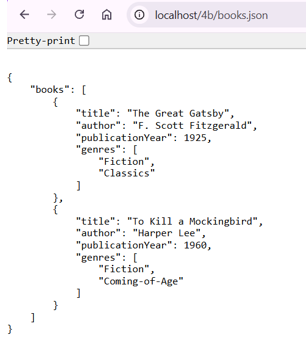
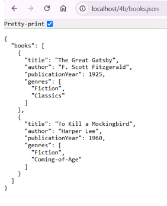
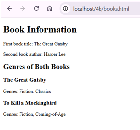
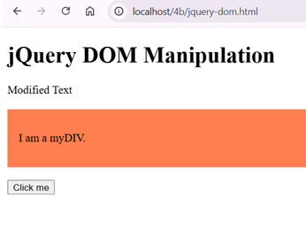
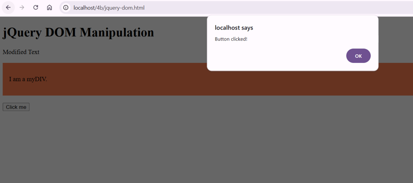

BIC21203 Web Development – Lab 4b

Overview

This lab focuses on JSON data handling, loading data using JavaScript, and DOM manipulation using jQuery.

Question 1: JSON Book Data

Files: books.json and books.html

This question demonstrates how book information is organized in JSON format and handled through a webpage.

Question 2: Loading Book Data Using Fetch

Files: books.html and books.json

This question demonstrates how to retrieve and display book data using JavaScript. The files should be run through a local server to ensure the data can be loaded correctly.

Question 3: jQuery DOM Manipulation

File: jquery-dom.html

This question demonstrates how jQuery can be used to manipulate HTML elements and update webpage content dynamically.

How to Run

1. Download or clone this repository to your computer.

2. Open the project folder in Visual Studio Code.

3. Start a local server using Live Server or another suitable local server.

4. Open books.html through the local server to test the book data loading functionality.

5. Open jquery-dom.html through the local server to test the jQuery functionality.

6. Check the webpage outputs against the provided screenshots.